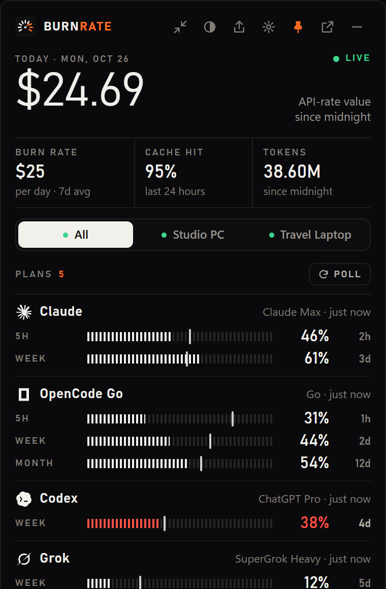
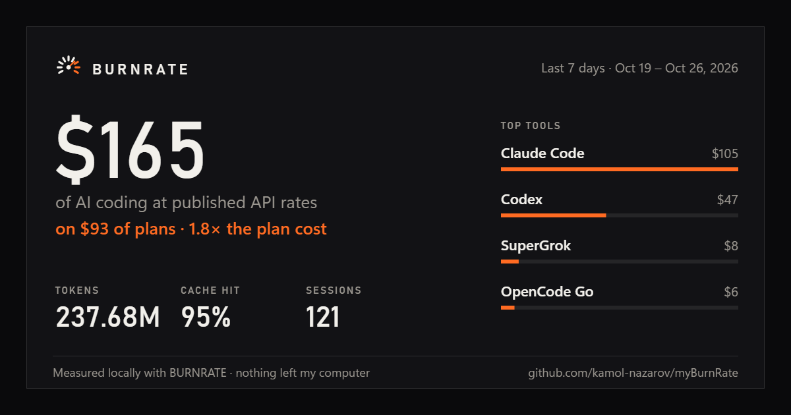

# BURNRATE

**See what your AI coding agents are worth, and which plan runs out first.**

BURNRATE reads the usage your coding tools already record on your computer (Claude Code, Codex,
OpenCode, Grok Build, Antigravity and more), prices it at published API rates, and shows it beside
your plans' limits in a small window that stays on top. It runs on your computer. There is no
account, no cloud and no analytics.

[](https://github.com/kamol-nazarov/myBurnRate/actions/workflows/ci.yml)
[](https://github.com/kamol-nazarov/myBurnRate/releases)
[](LICENSE)

<p align="center">
  
</p>

<p align="center"><sub>Screenshots use the made-up data from <code>burnrate demo</code>.</sub></p>

## What it shows

- **Today's usage at API rates**, with your burn rate per day, cache hit rate and tokens.
- **Every plan window** (5-hour, weekly, monthly) with the share used, an even-pace mark and the time
  until it resets, fullest first. A desktop notification warns you before a plan runs out.
- **Cost per repository**: today's value split by the repository each session ran in.
- **A weekly card** to share: the last seven days against what your plans cost.
- **All your computers in one view**: pair a laptop with your desktop, or run a small hub on a server.
- **Pay-as-you-go balances** (OpenRouter, DeepSeek) with how many days they last at your current spend.

<p align="center">
  
</p>

## Download

Get the newest version from **[Releases](https://github.com/kamol-nazarov/myBurnRate/releases)**.

| System | File |
| --- | --- |
| Windows 10 or 11 (64-bit) | `BURNRATE_<version>_x64-setup.exe` |
| macOS 11 or later (Apple Silicon) | `BURNRATE_<version>_aarch64.dmg` |
| Linux (x86-64) | `BURNRATE_<version>_amd64.AppImage` or `.deb` |

The Windows installer needs no administrator rights. The app updates itself: it checks for a new
version every few hours and offers it in the HUD and the tray menu.

On Windows you can also install from the command line with [Scoop](https://scoop.sh):

```powershell
scoop install https://github.com/kamol-nazarov/myBurnRate/releases/latest/download/myburnrate.json
```

A winget listing (`KamolNazarov.myBurnRate`) follows once the installer is code-signed.

**Opening it the first time**

- **Windows:** until code signing is approved (see [below](#code-signing-policy)), SmartScreen may say
  "Windows protected your PC". Choose **More info**, then **Run anyway**.
- **macOS:** the app is not notarized, so macOS blocks the first launch. Open **System Settings →
  Privacy & Security** (System Preferences → Security & Privacy on macOS 12 and earlier) and choose
  **Open Anyway** next to BURNRATE. Or run
  `xattr -dr com.apple.quarantine /Applications/BURNRATE.app` once.
- **Linux:** make the AppImage executable (`chmod +x BURNRATE_*.AppImage`), or install the `.deb`.

Every release file is built on GitHub Actions from a tagged commit, with a
[build provenance record](https://github.com/kamol-nazarov/myBurnRate/attestations) and a
`SHA256SUMS` file.

## Get started

1. **Install and open BURNRATE.** Setup opens on first launch.
2. **Choose how this computer works:** on its own, joined to your hub, or as the hub. Setup lists each
   tool it found, whether its usage and plan meter are being read, and what to do about anything
   missing.
3. **Add your plans and finish.** Plans are suggested from what your meters report; check each price.
   The HUD then stays on top of your other windows, and the tray icon opens setup, the HUD and updates.

Want to look around first? Run `burnrate demo` from a [source install](docs/development.md) to open
the HUD with a month of made-up data.

## Supported tools

| Tool | Usage and value | Plan meter |
| --- | --- | --- |
| Claude Code | yes | 5-hour and weekly, from the usage Claude Code and Claude Desktop cache |
| Codex | yes | weekly |
| OpenCode with a Z.AI Coding Plan, and ZCode | yes | 5-hour and weekly |
| OpenCode Go | yes | 5-hour, weekly and monthly |
| Grok Build | yes | weekly |
| Google Antigravity | yes | Gemini and other-model windows |
| Muse Code | yes | 5-hour and weekly |
| OpenRouter (through Traycer) | yes | account balance, with a management key |
| DeepSeek | — | account balance, with an API key |
| OpenAI and Anthropic organizations | optional, with an admin key | — |

Several of these read undocumented files or endpoints and are marked experimental; each can fail on
its own without affecting the others. Extra Claude Code accounts and OpenCode profiles appear as their
own lanes. Details for every source: [providers](docs/providers.md).

## Privacy

- BURNRATE listens on `127.0.0.1` only.
- It opens other tools' files read-only and never writes them. It never reads or reuses Claude's
  sign-in.
- Its database holds numbers: times, model names, token counts, project folder names and plan
  readings. It never stores prompts, responses, code or tool output.
- Network calls are few and named. The app checks GitHub for updates. The Z.AI and OpenCode Go
  meters (on by default, with a switch in setup) use the key those tools already store and contact
  only their own provider. OpenRouter, DeepSeek and the admin APIs run only with a key you add. Only a
  hub you set up receives your usage.

Read the [privacy notes](docs/privacy.md) for every file and host.

## More than one computer

Make one computer the hub in setup, then join each other computer with a pairing code it creates.
The HUD then has a switcher for **All** and each computer. To run the hub on a server instead, there is
a [Docker image with HTTPS](docs/self-hosting.md).

## Code signing policy

Free code signing provided by [SignPath.io](https://about.signpath.io/), certificate by
[SignPath Foundation](https://signpath.org/). The application is pending; until it is approved,
Windows installers are unsigned.

Only the Windows installer built by this repository's release workflow is signed, and each signing
request is approved by hand. Committers, reviewers and approvers:
[kamol-nazarov](https://github.com/kamol-nazarov). The full policy, including what the app sends over
the network, is in [docs/code-signing.md](docs/code-signing.md).

## Build from source

```powershell
git clone https://github.com/kamol-nazarov/myBurnRate.git
cd myBurnRate
python -m pip install -e ".[dev]"   # Python 3.12
burnrate demo                       # or: burnrate serve
```

Tests, the desktop app, the Windows service scripts and the front-end build are covered in
[development](docs/development.md). Contributions are welcome; see [CONTRIBUTING.md](CONTRIBUTING.md).

## Documentation

- [User guide](docs/user-guide.md): setup, notifications, several computers, the dashboard, and what
  the numbers mean
- [Configuration and command line](docs/configuration.md)
- [Providers](docs/providers.md), [pricing](docs/pricing.md), [plans and value](docs/plans-value.md)
- [Privacy](docs/privacy.md), [troubleshooting](docs/troubleshooting.md),
  [running your own hub](docs/self-hosting.md)
- [Architecture](docs/architecture.md), [releasing](docs/releasing.md), [changelog](CHANGELOG.md)

## License

[Apache-2.0](LICENSE).

BURNRATE is not affiliated with OpenAI, Anthropic, xAI, Google, Z.AI, OpenRouter, DeepSeek, Traycer,
Muse or their products. Trademarks belong to their owners.
