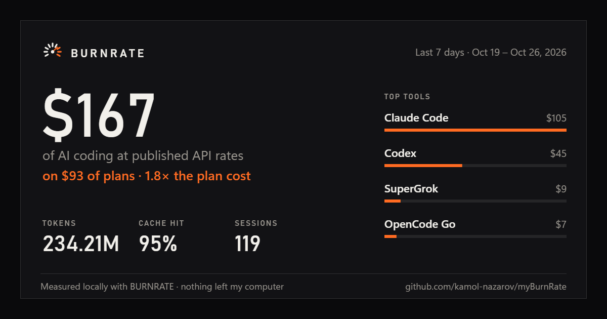

# BURNRATE

**Local-first AI coding usage, plan limits, and API-equivalent pricing in one compact desktop window.**

BURNRATE reads the usage your coding tools already record on your computer (Claude Code, Codex,
OpenCode, Grok Build, Google Antigravity, Muse Code, and more), prices it at published API rates,
and shows what is left of each plan window or prepaid balance. Everything runs locally on
`127.0.0.1` — no cloud account, no proxy, and no analytics.

[](https://github.com/kamol-nazarov/myBurnRate/actions/workflows/ci.yml)
[](https://github.com/kamol-nazarov/myBurnRate/releases/latest)
[](LICENSE)

<p align="center">
  
</p>

<p align="center"><sub>Screenshots use synthetic sample data from <code>burnrate desktop --demo</code>.</sub></p>

## Install

### Windows 10 or 11 (Native Desktop App — Recommended)

Install **myBurnRate** for your user account (no administrator rights required) with one PowerShell command — it checks `native-latest.json`, verifies the installer's SHA-256 hash, installs to `%LOCALAPPDATA%\Programs\BURNRATE`, adds Start Menu and Desktop shortcuts, and opens the app:

```powershell
irm https://raw.githubusercontent.com/kamol-nazarov/myBurnRate/prod/scripts/install-native.ps1 | iex
```

Or download **`myBurnRate_0.5.5_x64-setup.exe`** directly from **[Latest Release](https://github.com/kamol-nazarov/myBurnRate/releases/latest)**. Installed copies check for updates and offer one-click **Install & restart** inside **Settings → General**.

### All platforms & installers

Get every release bundle from **[Releases](https://github.com/kamol-nazarov/myBurnRate/releases/latest)**:

| System | File | Notes |
| --- | --- | --- |
| Windows 10 or 11 (64-bit) | `myBurnRate_<version>_x64-setup.exe` | **Native desktop window** (Light & Dark themes, 2-column provider tiles, tray mode, verified in-app updates). |
| Windows 10 or 11 (64-bit) | `BURNRATE_<version>_x64-setup.exe` | Sidecar HUD & full web dashboard (`scoop install` also installs this edition). |
| macOS 11 or later (Apple Silicon) | `BURNRATE_<version>_aarch64.dmg` | Sidecar HUD & full web dashboard. |
| Linux (x86-64) | `BURNRATE_<version>_amd64.AppImage` or `.deb` | Sidecar HUD & full web dashboard. |
| Python 3.12 (Windows / macOS / Linux) | `burnrate-<version>-py3-none-any.whl` | CLI, background service (`burnrate serve`), and `burnrate desktop`. |

On Windows you can also install the HUD edition with [Scoop](https://scoop.sh):

```powershell
scoop install https://github.com/kamol-nazarov/myBurnRate/releases/latest/download/myburnrate.json
```

A winget listing (`KamolNazarov.myBurnRate`) follows once the installer is code-signed.

**Opening it the first time**

- **Windows:** until code signing is approved (see [below](#code-signing-policy)), SmartScreen may say
  "Windows protected your PC". Choose **More info**, then **Run anyway**.
- **macOS:** the app is not notarized, so macOS blocks the first launch. Open **System Settings →
  Privacy & Security** (System Preferences → Security & Privacy on macOS 12 and earlier) and choose
  **Open Anyway** next to BURNRATE. Or run
  `xattr -dr com.apple.quarantine /Applications/BURNRATE.app` once.
- **Linux:** make the AppImage executable (`chmod +x BURNRATE_*.AppImage`), or install the `.deb`.

Every release file is built on GitHub Actions from a tagged commit, with a
[build provenance record](https://github.com/kamol-nazarov/myBurnRate/attestations) and a
`SHA256SUMS` file.

## What it shows

- **Today's usage at API rates**, with an interactive timeline, burn rate, cache hit rate, and value vs. plan cost.
- **Every plan window** (5-hour, weekly, monthly) with remaining share, reset countdown, and low-quota alerts.
- **Compact two-column provider tiles** that expand full-width for detailed window meters, recorded tokens, input/cache/output/reasoning breakdown, and per-model spend — reorderable via drag-and-drop or `Alt+Arrow`.
- **Multiple accounts per tool**: separate Claude Code profiles or OpenCode accounts appear as distinct tagged tiles.
- **All your computers in one view**: pair a laptop with your desktop, or sign in to a self-hosted hub from **Settings → Computers**.
- **Pay-as-you-go balances** (OpenRouter, DeepSeek) alongside subscription tools.

<p align="center">
  
</p>

## Get started

1. **Install and open myBurnRate.** On first launch, it detects the AI coding tools already on your computer.
2. **Connect optional balances or a multi-computer hub** in **Settings → Sources** and **Settings → Computers**.
3. **Pin or tuck into the tray:** pin the window above other apps, let it gently fade when idle, or close it to the notification area while background tracking continues.

Want to try it with sample data first? From a [source install](docs/development.md), run `burnrate desktop --demo` (or `burnrate demo` for the HUD).

## Supported tools

| Tool | Usage and value | Plan meter |
| --- | --- | --- |
| Claude Code | yes | 5-hour and weekly, from the usage Claude Code and Claude Desktop cache |
| Codex | yes | weekly |
| OpenCode with a Z.AI Coding Plan, and ZCode | yes | 5-hour and weekly |
| OpenCode Go | yes | 5-hour, weekly and monthly |
| Grok Build | yes | weekly |
| Google Antigravity | yes | Gemini and other-model windows |
| Muse Code | yes | 5-hour and weekly |
| OpenRouter (through Traycer) | yes | account balance, with a management key |
| DeepSeek | — | account balance, with an API key |
| OpenAI and Anthropic organizations | optional, with an admin key | — |

Several of these read undocumented files or endpoints and are marked experimental; each can fail on
its own without affecting the others. Extra Claude Code accounts and OpenCode profiles appear as their
own tiles. Details for every source: [providers](docs/providers.md).

## Privacy

- BURNRATE listens on `127.0.0.1` only.
- It opens other tools' files read-only and never writes them. It never reads or reuses Claude's
  sign-in.
- Its database holds numbers: times, model names, token counts, project folder names and plan
  readings. It never stores prompts, responses, code or tool output.
- Network calls are few and named. Installed copies check GitHub Releases for updates (`BURNRATE_NO_UPDATE_CHECK=1` disables all update checks). The Z.AI and OpenCode Go
  meters (on by default, with a switch in setup) use the key those tools already store and contact
  only their own provider. OpenRouter, DeepSeek and the admin APIs run only with a key you add. Only a
  hub you set up receives your usage.

Read the [privacy notes](docs/privacy.md) for every file and host.

## More than one computer

Sign in to a hub from **Settings → Computers** (or join with a pairing code) so **All computers** combines usage across your desktop and laptop while letting you filter to any single machine. To run a hub on your own server, use the [Docker setup with HTTPS](docs/self-hosting.md) (`ghcr.io/kamol-nazarov/myburnrate-hub`).

## Code signing policy

Free code signing provided by [SignPath.io](https://about.signpath.io/), certificate by
[SignPath Foundation](https://signpath.org/). The application is pending; until it is approved,
Windows installers are unsigned.

Only the Windows installers built by this repository's release workflow are signed, and each signing
request is approved by hand. Committers, reviewers and approvers:
[kamol-nazarov](https://github.com/kamol-nazarov). The full policy, including what the app sends over
the network, is in [docs/code-signing.md](docs/code-signing.md).

## Build from source

```powershell
git clone https://github.com/kamol-nazarov/myBurnRate.git
cd myBurnRate
python -m pip install -e ".[dev]"          # Python 3.12
burnrate desktop                           # Native desktop window (or --demo)
python packaging/build_native.py           # Build portable zip + NSIS installer
```

Tests, the native desktop app ([native-app.md](docs/native-app.md)), the Windows service scripts and the front-end build are covered in
[development](docs/development.md). Contributions are welcome; see [CONTRIBUTING.md](CONTRIBUTING.md).

## Documentation

- [Native desktop app](docs/native-app.md): everyday use, per-user installer, verified in-app updates, and building from source
- [User guide](docs/user-guide.md): setup, notifications, several computers, the dashboard, and what
  the numbers mean
- [Configuration and command line](docs/configuration.md)
- [Providers](docs/providers.md), [pricing](docs/pricing.md), [plans and value](docs/plans-value.md)
- [Privacy](docs/privacy.md), [troubleshooting](docs/troubleshooting.md),
  [running your own hub](docs/self-hosting.md)
- [Architecture](docs/architecture.md), [releasing](docs/releasing.md), [changelog](CHANGELOG.md)

## License

[Apache-2.0](LICENSE).

BURNRATE is not affiliated with OpenAI, Anthropic, xAI, Google, Z.AI, OpenRouter, DeepSeek, Traycer,
Muse or their products. Trademarks belong to their owners.
