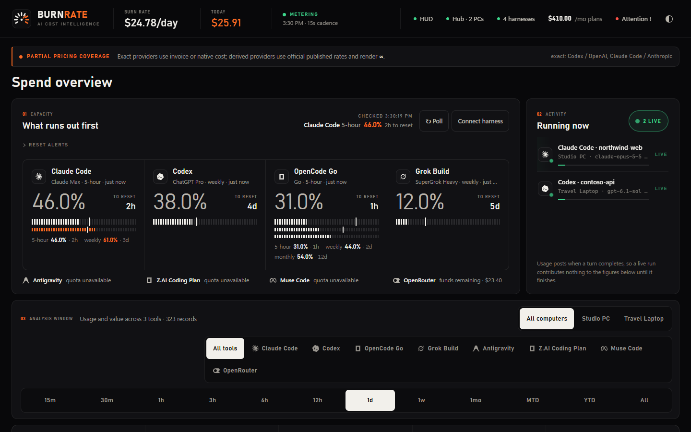

# User guide

Everything the [README](../README.md) leaves out: what each part of the app does, how setup and
multiple computers work, and what the numbers mean.

## What's in the app

- **Setup Wizard (`/setup`)**: Choose how this computer works (on its own, joined to your hub, or as the hub), see every HUD card's real state with the fix for anything missing, add plans suggested from your meters, connect pay-as-you-go balances, and check the live HUD before finishing.
- **Unified Spend & Capacity Dashboard (optional)**: Off by default. With `BURNRATE_ENABLE_DASHBOARD=1` it is served at `/`; otherwise `/` opens the HUD.
  - **Live Capacity & Run-Dry Forecasting**: Per-provider quota gauges sorted by *what runs out first*, projecting when a 5-hour or weekly window will exhaust based on your recent burn pace, with configurable in-app and browser alerts.
  - **Plans & Value**: Compare `This month` or `Last month` subscription expense against recorded API-equivalent usage, shared tool associations, and value multiples.
  - **Action Center**: Tracks quota thresholds, monitored-source issues, and unpriced models with snooze/acknowledge workflows.
  - **Token & Unit Economics**: Breakdown of fresh input, cached input, cache writes, output, and reasoning tokens by tool, model, project, and session, plus counterfactual cache-savings calculations.
- **Always-on-Top Sidecar HUD (`/hud`)**: Frameless floating window (`380` wide, sized to its content) in a graphite or paper theme. It leads with today’s API-rate spend, then burn rate, cache reuse, and tokens, then every subscription window as a segmented meter row: percentage, an even-pace tick, and the time until that window resets. **Mini** collapses it to a `296`-wide glance strip with one line per plan (its tightest window); click a plan to list all of its windows. A poll that returns no value never blanks a meter: it keeps its last reading (dimmed) until that window resets. Drag it from any empty surface; Mini, Theme, Pin, and Hide stay clickable, and a double-click does not maximize it.
- **Cost per repository**: the HUD lists today's value by the repository each session ran in, worktrees included.
- **Weekly card**: the share button copies the last seven days as an image (value, plans, tokens, cache hit, top tools; never repository names).
- **Single-Account Multi-Computer Sync**: Pair laptops and secondary desktops to your primary Hub using a 1-click `brpair_...` pairing code. Spokes automatically push incremental token usage, sessions, and live agent state into your Hub database.
- **Native Desktop App (`src-tauri/`)**: Tauri v2 desktop wrapper with system tray menu (`Toggle Sidecar HUD`, `Toggle HUD Always on Top`, `Run Setup Wizard…`, `Quit BURNRATE`); its main window opens only for setup and automatic background process supervision.

## First-run setup

The desktop app opens setup on first launch. Open it again any time with the gear button on the HUD, **Run Setup Wizard…** in the tray menu, or [http://127.0.0.1:17331/setup](http://127.0.0.1:17331/setup). **Set up later** closes it until you open it yourself.

1. **This computer** — name it, then choose how it works:
   - **Just this computer:** usage stays here; no account.
   - **Join my hub:** paste a pairing code from your hub (or sign in to a hub account) and this computer's usage syncs in the background.
   - **Make this the hub:** pick the address other computers use to reach it and create a pairing code for each one.
2. **What we found** — one row per HUD card: whether the tool's usage is being read, whether its plan meter has a current reading, and what to do when it does not ("Open Antigravity…"). Extra Claude accounts and OpenCode profiles appear on their own rows. The two meters that use a key another app stores (Z.AI and OpenCode Go) show their switch right there.
3. **Plans & balances** — plans are suggested from what the meters report (for example **Claude Max 20x** from Claude Code's account tier); check each price before adding it. Connect OpenRouter and DeepSeek keys here; they are tested, then stored in your system's credential store (Windows Credential Manager, the macOS Keychain, or the Secret Service on Linux). [http://127.0.0.1:17331/connections](http://127.0.0.1:17331/connections) opens this step directly.
4. **Check** — a live preview of your HUD cards and a list of anything that still needs you, switches for desktop notifications (with **Send a test**), **Copy diagnostics**, then **Finish setup**.

**Desktop notifications.** The desktop service sends a desktop notification when a plan passes its alert level (90% unless set otherwise), when a plan will run out before it resets, when a meter has not updated for over an hour, or when hub sync keeps failing. Each is sent once per window or stretch, and quiet hours (22:00–07:00 by default) hold them back unless a run-out is under two hours away. A closed Antigravity or an idle Muse Code does not count as a stuck meter. Turn each kind off in the Check step, or all of them with `BURNRATE_DESKTOP_NOTIFICATIONS=0` in the per-user `.env` (`%LOCALAPPDATA%\BURNRATE\.env` on Windows).

**Copy diagnostics** puts a plain-text report on the clipboard: versions and builds, freshness, each meter's newest reading, recent failed runs and the last lines of the service logs. Keys, e-mail addresses and your home folder are removed, and nothing is sent anywhere.

The first collection runs in the background while you go through the steps; the wizard shows its progress per tool and never waits on it.

## More than one computer (hub and spoke)

BURNRATE supports single-account, self-hosted multi-computer synchronization without any external cloud service:

1. **On your hub computer:** open setup, choose **Make this the hub**, pick the address your other computers can reach (Tailscale or LAN), name the other computer and click **Create pairing code**. The code contains a key for this hub; share it only with your own computers.
2. **On the other computer:** install BURNRATE, open setup, choose **Join my hub** and paste the code. Its background scheduler then pushes usage, sessions and live agents to the hub every ingest cycle.
   - A hub account works too: choose **Account** under **Join my hub**. Signing in never creates an account; use **Create an account instead** (at least 8 characters).
   - Or run the lightweight CLI sync agent directly:
     ```powershell
     burnrate sync --hub http://<hub-ip>:17331 --token br_m_<id>_<secret>
     ```
3. **Filtering by computer:** once two or more computers are registered, a computer switcher (`All computers` + each machine name) appears in the dashboard and the Sidecar HUD.

## The HUD and the dashboard



The dashboard is off by default (`BURNRATE_ENABLE_DASHBOARD=1` turns it back on). It is a single-page app titled **BURNRATE · AI Cost Intelligence**, styled like an instrument panel: a graphite (dark) or paper (light) ground that follows your OS until you pick one with the theme button, DIN-style Bahnschrift numerals, hairline grids instead of cards, and a single ember accent reserved for what needs your eye. Quota meters are segmented gauges; sections are numbered `01`, `02`, … After `burnrate serve`, open [http://127.0.0.1:17331](http://127.0.0.1:17331).

A typical overview (synthetic demo data — not a real account):

- **Top nav.** A full-width strip: gauge mark and wordmark, burn rate, today’s spend (in ember), metering status (live, stale, or failed), and chips for the HUD, sync, harnesses, monthly plans, Attention, and the theme.
- **Coverage banner.** Which tools are billed-exact versus published-rate (`≈`). Unpriced usage is named, never filled in.
- **Capacity.** “What runs out first”: a hairline grid with one gauge per subscription. The tightest window is the large figure beside its reset countdown, and every weekly, 5-hour, or monthly window gets a segmented meter with an even-pace tick. Meters turn ember from 60% and red from 85%. Missing quotas stay blank.
- **Activity.** In-progress turns only. Opening an editor or an idle shell does not appear here. Usage totals update when a turn completes.
- **Analysis window.** `15m`, `30m`, `1h`, `3h`, `6h`, `12h`, `1d`, `1w`, `1mo`, `MTD`, `YTD`, `All`. The selected range is the inverted segment.
- **KPI band.** Tracked value, measured tokens, API-equivalent cost per million tokens, cache reuse, and session count in one hairline-divided strip.
- **Token activity chart.** Stacked by tool or cumulative, with per-tool totals below and a model price board plus an ember weekday-by-hour heatmap further down.
- **Recoverable / forecast.** Cache savings versus a no-cache counterfactual, and a labeled forecast of plan cost versus published-rate value.
- **Unit economics.** Cost by model (click through for a tool or model detail page), token mix (cached input / fresh input / output), and any subscriptions you configured, as hairline tables with inline share bars.

The Sidecar HUD at [http://127.0.0.1:17331/hud](http://127.0.0.1:17331/hud) uses the same system in a narrow window: today’s spend as one large readout, a three-cell strip (burn rate, cache, tokens), any live agents, then one aligned meter row per plan window with its percentage and reset countdown. Mini mode keeps only today’s spend and each plan’s tightest window.

Public screenshots use the made-up data from `burnrate demo` (fictional Northwind-style project names and placeholder figures), never a live database.

A fresh install with no harness history shows an empty state, not an error.

Use **Connect harness** for guided local discovery, manual locations, persistent connection status and optional documented provider API setup. See the [connection guide](connections.md) for capabilities, credential requirements and development verification limits.

See [subscription management](subscriptions.md) for effective-dated plans, and [earlier release notes](releases/RELEASE-0.2.0-beta.2.md) for accounting, schema migration, source resilience, and credential consent details.

## What it measures, and what it does not

**Measures**

- Completed-turn token classes when the harness reports them: fresh input, cache read, cache write (including Anthropic 5-minute / 1-hour writes when distinct), output, and reasoning when it is a separate field.
- Cache hit rate from those measured components: cache-read input ÷ measured total input. Unclassified schemas are excluded from the rate, not estimated.
- Subscription burn you configure yourself (daily proration of the amount you entered).
- Published-rate *equivalents* from effective-dated YAML price cards.
- Capacity snapshots when a quota source exists.

**Does not measure**

- Prompts, responses, diffs, tool payloads, attachments, or source code.
- Inference latency as a spend proxy.
- “You should have used model X” as a fact.
- Spend for traffic with no trustworthy amount.
- Opening an editor, an idle Composer, or an idle shell as a live session.
- Direct xAI API usage or Requesty (neither is connected).

BURNRATE never reroutes completions. Cache behavior of the underlying providers is unchanged.

## Exact, derived and unavailable

| Label | Meaning | UI |
| --- | --- | --- |
| **Exact** | Invoice-authoritative usage source **and** a YAML card with `exactness: exact`. Today that is Codex local / OpenAI admin and Claude local / Anthropic admin. | plain number |
| **Derived** / published-rate | Included-plan attribution at published API rates, or a card marked `exactness: derived`. Not a bill. | `≈` when complete, `≥` when only a priced subset is known |
| **Unavailable** | No trustworthy sample (missing file, skipped key, incomplete telemetry, unpriced model). | `—` — **never `$0`** |
| **Partial** | Some events in the window are priced and some are not. | named as partial |
| **Forecast** | Projection from paced usage. Incomplete pricing is a known-spend floor, not a complete projection. | labeled forecast |

Cache savings is the per-event no-cache counterfactual, not a blended ratio. If any cached event in the window is unpriced or telemetry-incomplete, savings is unavailable rather than silently small.

Reasoning tokens that the harness already includes in output are displayed as detail and are not added twice.

More: [docs/pricing.md](pricing.md).

## More than one account, and pay-as-you-go balances

### More than one Claude account

Claude Code keeps one signed-in account per config directory. Run a second account with `CLAUDE_CONFIG_DIR=%USERPROFILE%\.claude-work` (any `.claude-<name>` works), sign in once, and BURNRATE shows it as its own plan lane, **Claude Code · Work**, beside the default account in the dashboard, the Sidecar HUD, and the Mini HUD.

- Profiles are found automatically in `~/.claude-*`. Put other directories in `BURNRATE_CLAUDE_ACCOUNT_DIRS` (separated by `;` on Windows).
- A profile signed in to the same account as the default lane is ignored, so nothing is shown twice.
- Each lane reads the plan usage Claude Code itself cached for that profile, which needs no network call and no sign-in. An idle profile shows its last reading with its age, and a window whose reset has passed reads as reset.
- Lanes are named after the directory. The account's email address is never shown.

### More than one OpenCode profile

A second OpenCode profile is OpenCode started with `XDG_DATA_HOME` pointing at its own directory, such as `%USERPROFILE%\.opencode-go-2` or `%USERPROFILE%\.opencode-work`. When that profile is signed in to a different OpenCode Console account, BURNRATE shows its Go quota as its own lane, **OpenCode Go · Profile 2** or **OpenCode Go · Work**, beside the default OpenCode Go lane.

- Profiles are found automatically in `~/.opencode-*`. Put other directories in `BURNRATE_OPENCODE_PROFILE_DIRS` (separated by `;` on Windows).
- A profile signed in to the same account as the default profile is ignored.
- The lane uses only that profile's own stored key, under the same `BURNRATE_ENABLE_OPENCODE_GO_QUOTA` switch and cadence as the default Go lane. The key is never shown or stored by BURNRATE.
- The profile's own sessions are counted too, recorded under the card's key (`opencode-go-2`), so its card gets its own burn rate and run-out forecast. Extra Claude accounts work the same way from their `projects` folder.

### Pay-as-you-go balances

OpenRouter and DeepSeek show the money left on the account. Connect each one in **Connections → Add provider API**; the key is stored in your system's credential store.

- **OpenRouter** needs a *management* key from [openrouter.ai/settings/management-keys](https://openrouter.ai/settings/management-keys). An ordinary inference key is refused by the credits endpoint.
- **DeepSeek** takes an ordinary API key from [platform.deepseek.com](https://platform.deepseek.com/api_keys). BURNRATE uses it only to read the balance, never to run a model, and never borrows a key another tool stores. A balance reported only in CNY is shown as unavailable.
- **Runway.** After a day of readings each card says how long the balance lasts at the recent spend, for example *about 12 days at your current spend ($3.40/day)*. The figure comes from the last 14 days of balance readings (sampled hourly); a top-up is not counted as spend. The HUD shows the days left where plan rows show their reset time.

## Troubleshooting

```powershell
burnrate doctor
```

Doctor checks CPython 3.12, required imports, timezone data, a read-only SQLite integrity check, packaged pricing YAML, packaged web assets, and that the default bind is loopback. It does not migrate, does not walk provider paths, does not inspect credentials, and does not print secrets. Run `burnrate init` first; doctor will not create `spend.db`.

Common cases:

- Empty HUD after install — expected until one of your tools records usage; setup's **What we found** step shows what is being read.
- Admin job `skipped` — empty key; not a failure.
- `unavailable` / `—` — missing telemetry or pricing; not zero.
- Port `17331` already in use — another BURNRATE process is running (`.\scripts\status-burnrate.ps1`).
- Amber status pill naming a source (for example `MUSE WEEKLY HELD` or `TRAYCER FAILED`) — that source or meter on *this* computer stopped refreshing. Hover the pill (or open **Diagnostics → Freshness**) for the reason and its age; `GET /api/spend/freshness` returns the same report and is never proxied to the hub.
- Service logs live in `%LOCALAPPDATA%\BURNRATE\logs\dashboard.log` and rotate at 5 MB (three backups kept). Each local collection pass logs one line with its duration and slowest sources; the collection worker logs to `collector.log`.
- Asking for help — **Copy diagnostics** in setup's Check step collects versions, freshness, meters and recent log lines with secrets removed.
- Experimental provider down — that lane fails independently.

Full legend: [troubleshooting](troubleshooting.md).
